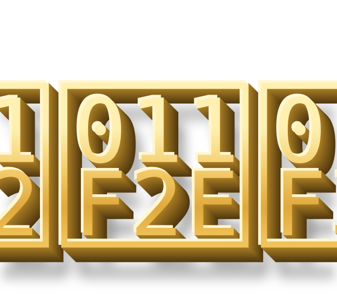
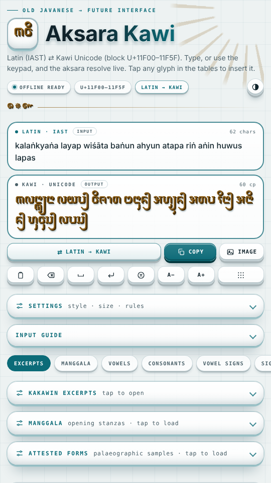
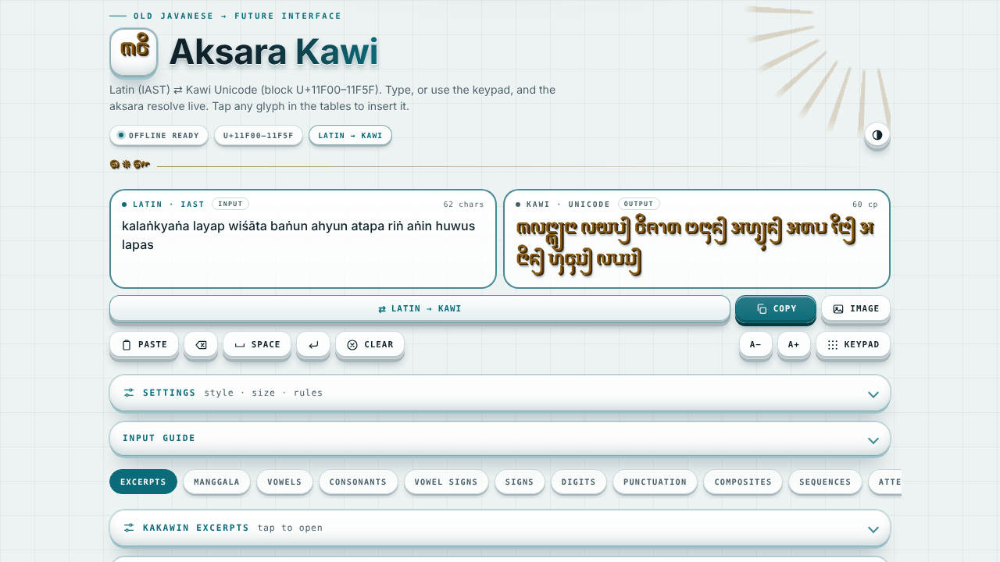

<p align="center">
  
</p>

<h1 align="center">Aksara Kawi · Transliteration Console</h1>

<p align="center">
  Latin (IAST) ⇄ Kawi Unicode, dengan keypad aksara, tabel karakter, dan kutipan kakawin.<br>
  Satu file HTML, jalan offline, bisa dipasang seperti aplikasi.<br>
  <a href="https://rakawi182.github.io/Kawi/"><b>Buka aplikasi</b></a>
</p>

<p align="center">
  
  &nbsp;
  
</p>

> **English:** an offline, installable web app (PWA) that converts Latin (IAST) to Kawi Unicode
> (U+11F00–U+11F5F) and back, with an on-screen aksara keypad. Install it from the browser on
> Android, iPhone/iPad, Windows, macOS and Linux. MIT licensed; the Noto Sans Kawi font is SIL OFL 1.1.

## Fitur

- Konversi **Latin (IAST) ⇄ Kawi Unicode** secara langsung, termasuk gugus konsonan (conjoiner),
  *repha*, *killer*, dan kasus khusus (lihat panel *Input guide* di dalam aplikasi).
- **Keypad aksara** bergaya tombol timbul untuk mengetik tanpa keyboard Kawi.
- Tabel huruf vokal, konsonan, tanda vokal, angka, tanda baca, gabungan, dan urutan bertanda
  (berdasarkan proposal Unicode Kawi).
- Gaya tampilan aksara (termasuk gaya prasasti batu dan lontar) dan **ekspor gambar** (PNG/JPG).
- Kutipan **kakawin** dengan nama penyair dan rujukan (lihat [CITATIONS.md](CITATIONS.md)).
- Fon Noto Sans Kawi **tertanam**, jadi tidak butuh internet setelah dimuat pertama kali.

## Pasang sebagai aplikasi

Buka alamat situs (HTTPS) di peramban, lalu:

| Perangkat | Cara |
|---|---|
| **Android** (Chrome, Edge, Samsung Internet) | Menu ⋮ → **Instal aplikasi** / **Tambahkan ke layar utama** |
| **iPhone / iPad** (harus **Safari**) | Tombol Bagikan ⬆︎ → **Tambah ke Layar Utama** |
| **Windows** (Edge atau Chrome) | Ikon instal di ujung kanan bilah alamat, atau menu → **Instal Aksara Kawi** |
| **macOS** (Chrome/Edge; Safari: *File → Add to Dock*) | Ikon instal di bilah alamat |
| **Linux** (Chrome, Chromium, Edge, Brave) | Ikon instal di bilah alamat. Firefox desktop belum mendukung instal PWA; tetap bisa dipakai di tab. |

Aplikasi terpasang punya ikon sendiri, jendela tanpa bilah alamat, dan bisa dibuka offline.

## Hosting di GitHub Pages

Semua berkas ada di satu tingkat (tanpa folder), jadi bisa diunggah langsung lewat
**Add file → Upload files** di https://github.com/rakawi182/Kawi (berkas lama seperti
`aksara_kawi.html` boleh tetap ada; halaman utama situs adalah `index.html`).

1. Unggah semua berkas, lalu **Commit changes**.
2. **Settings → Pages → Build and deployment → Source: Deploy from a branch**,
   Branch: `main`, folder: `/ (root)` → **Save**.
3. Tunggu satu-dua menit; situs tayang di `https://rakawi182.github.io/Kawi/`.
4. Opsional: **Settings → General → Social preview** → unggah `social-preview.png`.

Semua jalur di `manifest.webmanifest` dan `sw.js` bersifat relatif, jadi aplikasi berjalan
baik di `https://rakawi182.github.io/Kawi/` maupun di domain sendiri.

## Jalankan lokal

```bash
python3 -m http.server 8000
# buka http://localhost:8000
```

Service worker (offline/instal) hanya aktif lewat **HTTPS** atau **localhost**; membuka
`index.html` langsung dari berkas (`file://`) tetap berfungsi sebagai halaman biasa.

## Merilis versi baru

Setiap kali `index.html` atau aset berubah, naikkan `CACHE` di `sw.js` (mis. `aksara-kawi-v2`)
agar pengguna yang sudah memasang aplikasi mendapat berkas terbaru.

## Berkas

```
index.html                              aplikasi lengkap (satu file, fon tertanam)
manifest.webmanifest, sw.js             PWA: metadata dan cache offline
logo.svg, wordmark.svg                  logo "Kawi" (ikon aplikasi / latar transparan)
icon-192/512.png, icon-maskable-*.png   ikon PWA (Android, Windows, Linux)
apple-touch-icon.png                    ikon layar utama iOS
favicon.ico, favicon.svg, favicon-32.png
screenshot-wide.png, screenshot-narrow.png   tangkapan layar dialog instal
social-preview.png                      gambar pratinjau repositori
LICENSE  OFL.txt  THIRD_PARTY_NOTICES.md  CITATIONS.md  CITATION.cff  CHANGELOG.md
```

## Logo

Kata **Kawi** (𑼒𑼮𑼶, U+11F12 U+11F2E U+11F36) dalam aksara Kawi, emas dengan efek 3D bertumpuk
seperti tombol keypad. `logo.svg` adalah ikon aplikasi, `wordmark.svg` latar transparan.
Fon pada SVG sudah tertanam (subset tiga glyph), sehingga tampil sama di semua perangkat.

## Lisensi dan kredit

- Kode dan logo: [MIT](LICENSE).
- Fon **Noto Sans Kawi** © 2023 The Noto Project Authors, [SIL OFL 1.1](OFL.txt).
- Sumber ilmiah, proposal Unicode, dan penyair kakawin: [CITATIONS.md](CITATIONS.md).
  Terjemahan Indonesia pada kutipan adalah terjemahan bebas yang ditulis untuk aplikasi ini;
  periksa edisi kritis sebelum mengutip.

Untuk mengutip perangkat lunak ini, gunakan [CITATION.cff](CITATION.cff) (tombol *Cite this repository* di GitHub).
